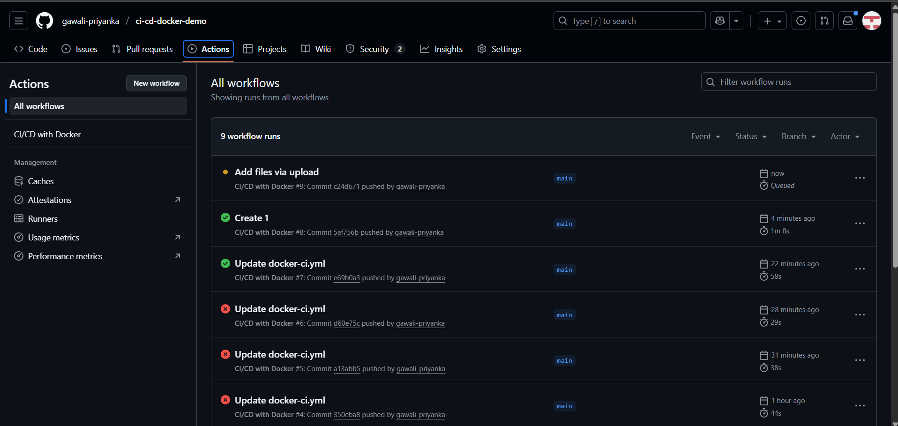
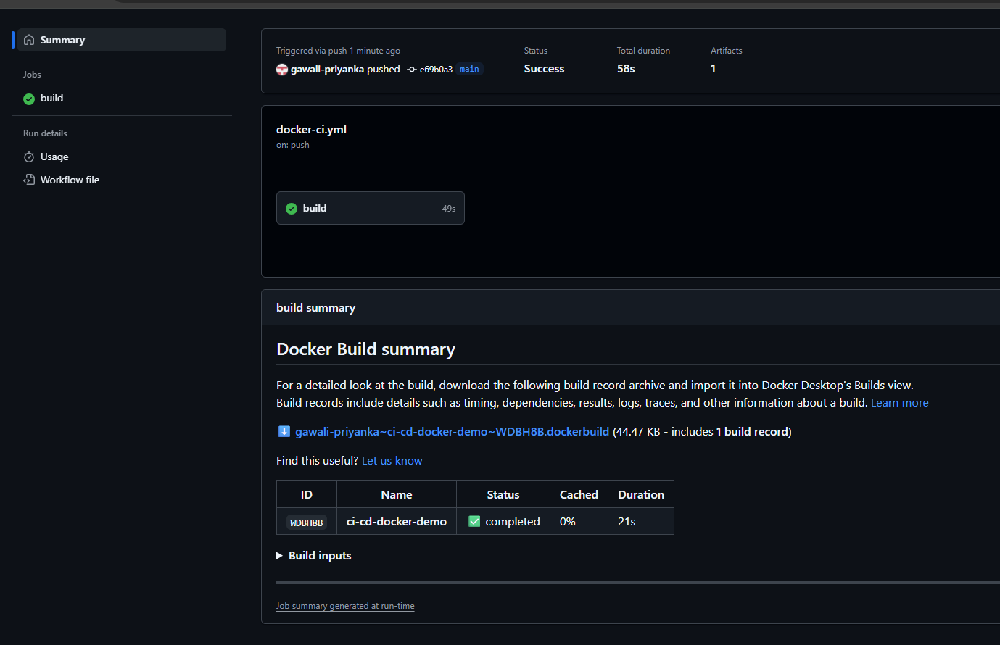
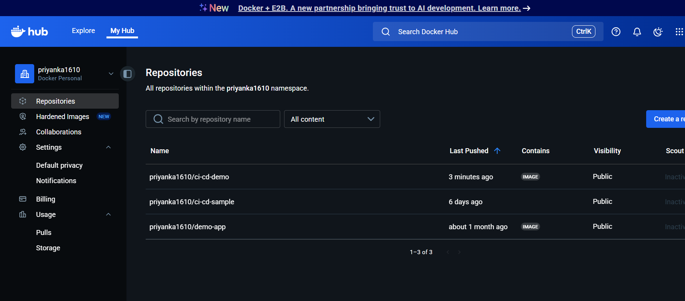
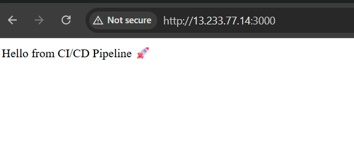

# CI/CD Pipeline with GitHub Actions & Docker

A beginner-friendly DevOps project: a small Node.js/Express app that is **tested, containerized, and pushed to Docker Hub automatically** on every push to `main`.

## Pipeline flow

```
git push ─► GitHub Actions ─► [test job] ─► [docker job] ─► Docker Hub ─► run anywhere (EC2 / local)
                               npm ci         build image     :latest
                               npm test       smoke test      :<commit-sha>
```

| Event | Test | Build image | Push to Docker Hub |
|-------|:----:|:-----------:|:------------------:|
| Pull request to `main` | ✅ | ✅ | ❌ |
| Push to `main` | ✅ | ✅ | ✅ |

## Tools used

- **GitHub Actions** – CI/CD automation
- **Docker** (multi-stage build, non-root user, healthcheck)
- **Docker Hub** – image registry
- **Docker Compose** – local run
- **Jest + Supertest** – automated tests
- **Node.js 20 & Express** – sample app
- **AWS EC2** – example deployment target

## Repository structure

```
.
├── .github/workflows/docker-ci.yml   # CI/CD pipeline
├── test/app.test.js                  # Automated tests
├── app.js                            # Express app (/ and /health)
├── package.json
├── Dockerfile                        # Multi-stage, non-root, healthcheck
├── docker-compose.yml                # Local run
├── .dockerignore / .gitignore
└── README.md
```

## Run locally

```bash
git clone https://github.com/<your-username>/ci-cd-docker-demo.git
cd ci-cd-docker-demo

npm install        # first time only – creates package-lock.json (commit it!)
npm test           # run tests
npm start          # http://localhost:3000
```

With Docker:

```bash
docker compose up --build -d
curl http://localhost:3000/health     # {"status":"ok",...}
docker compose down
```

## Set up the CI/CD pipeline

1. Create a Docker Hub **access token**: Docker Hub → Account Settings → Security → New Access Token.
2. In your GitHub repo go to **Settings → Secrets and variables → Actions → New repository secret** and add:
   - `DOCKERHUB_USERNAME` – your Docker Hub username
   - `DOCKERHUB_TOKEN` – the access token from step 1
3. Push to `main`. Watch the run in the **Actions** tab.

> ⚠️ **Never put tokens in the workflow file.** Always use GitHub Secrets. (The original version of this project had a token committed in plain text – if you ever did that, revoke the token on Docker Hub immediately.)

## Deploy on AWS EC2 (Amazon Linux 2023)

```bash
sudo dnf update -y
sudo dnf install docker -y
sudo systemctl enable --now docker
sudo usermod -aG docker ec2-user && newgrp docker

docker pull <DOCKERHUB_USERNAME>/ci-cd-demo:latest
docker run -d --name ci-cd-demo --restart unless-stopped -p 80:3000 <DOCKERHUB_USERNAME>/ci-cd-demo:latest
```

Open `http://<EC2-Public-IP>` (allow inbound port 80 in the security group).

## What I improved (learning notes)

| Area | Before | After |
|------|--------|-------|
| Secrets | Docker Hub token hardcoded in workflow | GitHub Secrets |
| Tests | `echo "No tests yet!"` | Jest + Supertest, run in CI before build |
| Image | `node:18` (~1 GB), runs as root | `node:20-alpine`, multi-stage, non-root `node` user |
| Reliability | none | `/health` endpoint + Docker `HEALTHCHECK` + `restart: unless-stopped` |
| Tags | only `latest` | `latest` + commit SHA (rollback-friendly) |
| PRs | pushed images from PRs | PRs build only, no push |
| Speed | none | npm cache + Docker layer cache (GHA cache) |
| Hygiene | – | `.dockerignore`, `.gitignore`, `npm ci`, removed obsolete compose `version` |

## Ideas to try next

- Add a CD step that SSHs into EC2 and pulls the new image
- Add a linter (ESLint) and Trivy image vulnerability scan to the pipeline
- Terraform the EC2 instance
- Add Prometheus/Grafana monitoring using `/health`

## Screenshots





